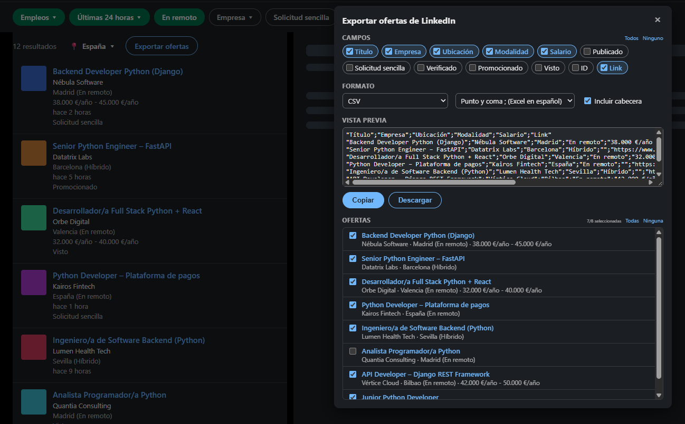

# Exportador de ofertas de LinkedIn

🇬🇧 [English version](README.md)

Extensión de Chrome que añade un botón **Exportar ofertas** en las búsquedas de empleo de LinkedIn para copiar o descargar las ofertas de la lista en el formato que necesites: texto, CSV, TSV, Markdown o JSON.

Solo lee lo que ya tienes en pantalla: no abre las ofertas, no hace peticiones a LinkedIn y no envía datos a ningún sitio.


<sub>Captura con ofertas y empresas ficticias.</sub>

## Por qué existe

Para buscar empleo uso un modelo de IA con mi CV, mi experiencia y mis criterios como contexto. Le paso las ofertas y, para cada una, lee la descripción, cruza los requisitos con mi perfil y me dice si encaja y por qué. Antes se las pasaba una a una; con esta extensión exporto todas las de una búsqueda en Markdown o JSON y las analiza de golpe. Así dedico mi tiempo a leer en detalle y preparar bien las candidaturas que de verdad encajan.

## Características

- **Botón integrado** junto al filtro de ubicación de la búsqueda.
- **Elige las ofertas**: todas las de la búsqueda o solo las que marques. Se ignoran las de «Hemos encontrado más resultados…», que no son coincidencias exactas.
- **Elige los campos**: título, empresa, ubicación, modalidad, salario, fecha de publicación, solicitud sencilla, verificado, promocionado, visto, ID y link.
- **Varios formatos**:
  | Formato | Uso típico |
  |---|---|
  | Texto | `título \| empresa \| link`, para pegar en notas o mensajes |
  | CSV | Abrir en Excel u otras herramientas. Separador a elegir: `;` (Excel en español), `,` o `\|` |
  | TSV | Pegar directamente en Excel o Google Sheets, cada campo en su columna |
  | Markdown | Tabla para documentación, Notion, GitHub… |
  | JSON | Procesar con scripts (las claves no cambian con el idioma) |
- **Vista previa** del resultado antes de copiar o descargar.
- **Recuerda tu configuración** (campos, formato, separador, cabecera).
- **Tema claro / oscuro**: sigue automáticamente el tema que tengas en LinkedIn.
- **Español / inglés**: sigue el idioma de LinkedIn (si no es español, inglés).

## Instalación

1. Descarga o copia esta carpeta en tu ordenador.
2. Abre `chrome://extensions` en Chrome (también funciona en Edge, Brave y otros navegadores basados en Chromium).
3. Activa el **Modo de desarrollador** (arriba a la derecha).
4. Pulsa **Cargar descomprimida** y selecciona esta carpeta (la que contiene `manifest.json`).

Para actualizar a una versión nueva: sustituye los archivos y pulsa ↻ en la tarjeta de la extensión.

## Uso

1. Haz una búsqueda de empleo en LinkedIn.
2. Pulsa **Exportar ofertas** (junto al filtro de ubicación).
3. Elige campos, formato y ofertas.
4. **Copiar** o **Descargar**.

## Campos disponibles

Todos se leen de las tarjetas de la lista, por lo que algunos dependen de lo que LinkedIn muestre en cada oferta:

| Campo | Notas |
|---|---|
| Título, Empresa, ID, Link | Siempre disponibles |
| Ubicación, Modalidad | La modalidad (remoto, híbrido, presencial) solo si LinkedIn la indica |
| Salario | Solo si la empresa lo publica |
| Publicado | LinkedIn lo sustituye por «Visto» en las ofertas que ya has abierto |
| Solicitud sencilla, Verificado, Promocionado, Visto | Sí / No según las etiquetas de la tarjeta |

La descripción completa («Acerca del empleo») no está incluida: LinkedIn solo la carga al abrir cada oferta.

## Seguridad y privacidad

Instalar una extensión en el navegador donde tienes tu sesión de LinkedIn requiere confianza, así que esto es exactamente lo que hace y lo que no:

**Lo que hace**
- Lee el texto de las tarjetas de ofertas que ya tienes en pantalla.
- Añade su botón y su panel a la página.
- Guarda tu configuración (campos, formato…) con `chrome.storage`, en tu navegador.
- Copia al portapapeles o descarga un archivo **solo cuando tú pulsas** Copiar o Descargar.

**Lo que no hace**
- No hace peticiones de red: no envía datos a ningún servidor, ni propio ni de terceros.
- No accede a cookies, contraseñas, mensajes ni a tu perfil.
- No pulsa nada ni realiza acciones en tu cuenta (no solicita ofertas, no envía mensajes).
- No carga código externo ni tiene dependencias.

**Permisos**
- `storage`: el único permiso que pide.
- Solo se ejecuta en `https://www.linkedin.com/*`.

**Cómo comprobarlo**
- Todo el código está en un único archivo legible y sin minificar: [`content.js`](content.js), menos de 500 líneas.
- En `chrome://extensions` → **Detalles** puedes ver los permisos que tiene.
- Si buscas `fetch`, `XMLHttpRequest`, `WebSocket` o `cookie` en el código, no aparecen.

## Limitaciones

- Depende de la estructura HTML de LinkedIn. Si LinkedIn la cambia, puede dejar de funcionar hasta que se ajusten los selectores.
- Exporta la página de resultados actual (unas 25 ofertas); para más, pasa de página y vuelve a exportar.
- La interfaz de LinkedIn en inglés está soportada pero menos probada que en español.

> **Aviso:** las condiciones de uso de LinkedIn no permiten la extracción automatizada de datos. Esta extensión solo lee lo que el propio usuario tiene en pantalla, a petición suya, pero úsala con sentido común y bajo tu responsabilidad.

## Estructura del proyecto

```
manifest.json
content.js          ← toda la lógica: botón, panel, extracción y exportación
_locales/es, en/    ← nombre y descripción traducidos
icons/
```

## Licencia

[MIT](LICENSE)
