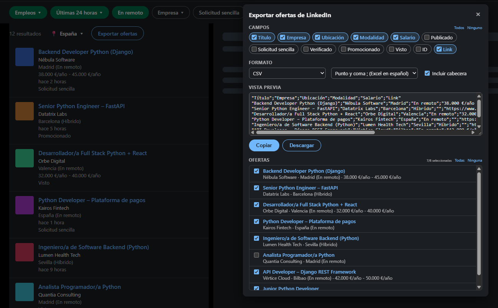

# LinkedIn Jobs Exporter

🇪🇸 [Versión en español](README.es.md)

A Chrome extension that adds an **Export jobs** button to LinkedIn job searches, so you can copy or download the listed jobs in the format you need: text, CSV, TSV, Markdown or JSON.

It only reads what is already on your screen: it does not open job postings, make requests to LinkedIn, or send data anywhere.


<sub>Screenshot with fictional jobs and companies. The interface follows LinkedIn's language (Spanish here).</sub>

## Why it exists

For my job search I use an AI model with my CV, experience and criteria as context. I give it job postings and, for each one, it reads the description, matches the requirements against my profile and tells me whether it's a fit and why. I used to pass postings one by one; with this extension I export every job from a search as Markdown or JSON and it analyzes them all at once. That way I spend my time reading in detail and preparing strong applications for the ones that really fit.

## Features

- **Built-in button** next to the search's location filter.
- **Pick the jobs**: every job in the search, or only the ones you tick. Results under LinkedIn's "more results" notice (not exact matches) are ignored.
- **Pick the fields**: title, company, location, workplace type, salary, posted date, Easy Apply, verified, promoted, viewed, ID and link.
- **Multiple formats**:
  | Format | Typical use |
  |---|---|
  | Text | `title \| company \| link`, to paste into notes or messages |
  | CSV | Open in Excel or other tools. Choice of separator: `;`, `,` or `\|` |
  | TSV | Paste straight into Excel or Google Sheets, one field per column |
  | Markdown | Table for docs, Notion, GitHub… |
  | JSON | Process with scripts (keys don't change with the language) |
- **Preview** of the output before copying or downloading.
- **Remembers your settings** (fields, format, separator, header).
- **Light / dark theme**: automatically follows your LinkedIn theme.
- **English / Spanish**: follows LinkedIn's language (Spanish if LinkedIn is in Spanish, English otherwise).

## Installation

1. Download or copy this folder to your computer.
2. Open `chrome://extensions` in Chrome (Edge, Brave and other Chromium-based browsers work too).
3. Turn on **Developer mode** (top right).
4. Click **Load unpacked** and select this folder (the one containing `manifest.json`).

To update to a new version: replace the files and click ↻ on the extension's card.

## Usage

1. Run a job search on LinkedIn.
2. Click **Export jobs** (next to the location filter).
3. Choose fields, format and jobs.
4. **Copy** or **Download**.

## Available fields

All fields are read from the job cards in the list, so some depend on what LinkedIn shows for each job:

| Field | Notes |
|---|---|
| Title, Company, ID, Link | Always available |
| Location, Workplace | Workplace type (remote, hybrid, on-site) only if LinkedIn shows it |
| Salary | Only if the company publishes it |
| Posted | LinkedIn replaces it with "Viewed" on jobs you've already opened |
| Easy Apply, Verified, Promoted, Viewed | Yes / No based on the card's labels |

The full description ("About the job") is not included: LinkedIn only loads it when you open each job.

## Security and privacy

Installing an extension in the browser where you're logged into LinkedIn takes trust, so here is exactly what it does and doesn't do:

**What it does**
- Reads the text of the job cards already on your screen.
- Adds its button and panel to the page.
- Stores your settings (fields, format…) with `chrome.storage`, in your browser.
- Copies to the clipboard or downloads a file **only when you click** Copy or Download.

**What it doesn't do**
- No network requests: it doesn't send data to any server, its own or third-party.
- No access to cookies, passwords, messages or your profile.
- It doesn't click anything or take actions on your account (no applying to jobs, no sending messages).
- It doesn't load external code and has no dependencies.

**Permissions**
- `storage`: the only permission it requests.
- Runs only on `https://www.linkedin.com/*`.

**How to verify**
- All the code is in a single, readable, unminified file: [`content.js`](content.js), under 500 lines.
- In `chrome://extensions` → **Details** you can see its permissions.
- Searching the code for `fetch`, `XMLHttpRequest`, `WebSocket` or `cookie` finds nothing.

## Limitations

- Depends on LinkedIn's HTML structure. If LinkedIn changes it, the extension may stop working until the selectors are updated.
- Exports the current results page (about 25 jobs); for more, go to the next page and export again.
- LinkedIn's English interface is supported but less tested than the Spanish one.

> **Note:** LinkedIn's terms of service do not allow automated data extraction. This extension only reads what the user already has on screen, on request, but use it sensibly and at your own risk.

## Project structure

```
manifest.json
content.js          ← all the logic: button, panel, extraction and export
_locales/es, en/    ← translated name and description
icons/
```

## License

[MIT](LICENSE)
